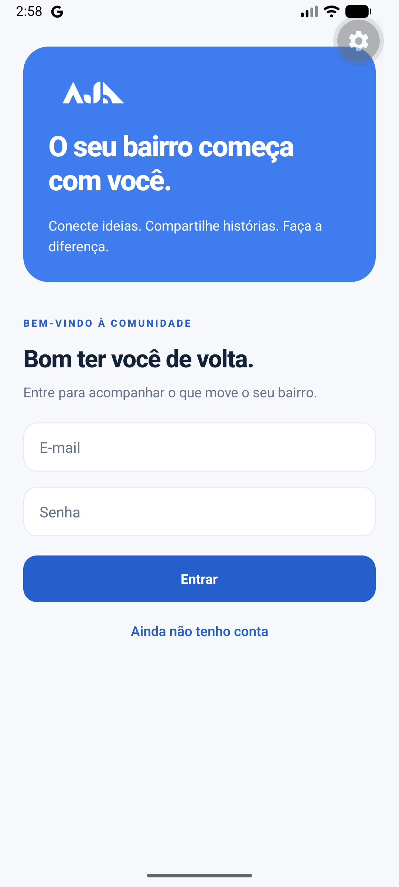
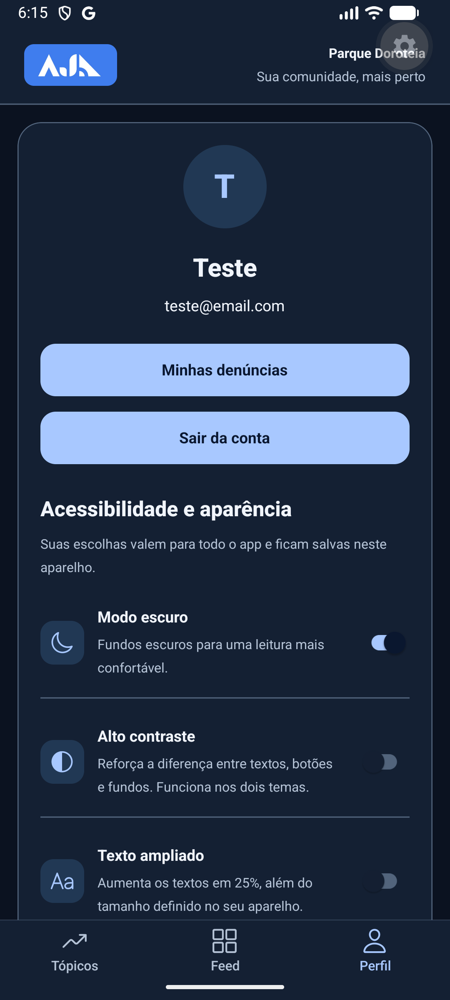
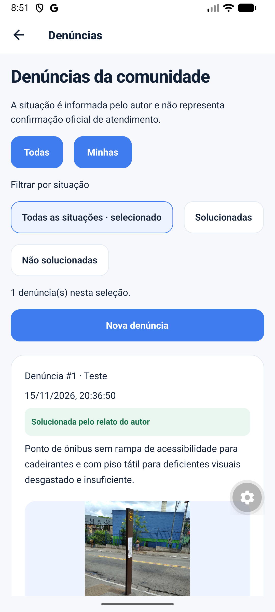
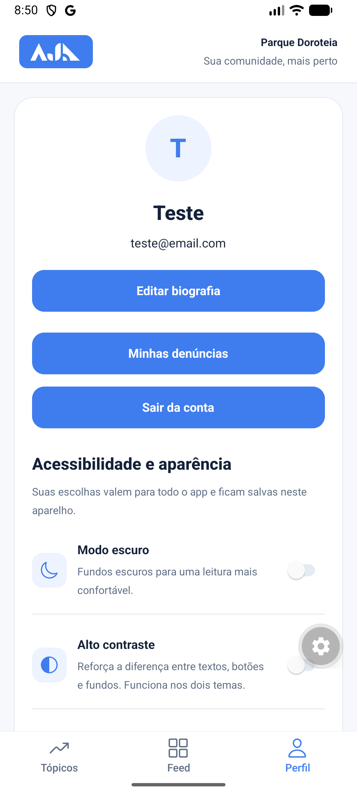

# AJA — sua comunidade, mais perto

Componente mobile da plataforma AJA, desenvolvido no contexto da Global Solution CitizenTech 2026 para a disciplina Mobile Development & IOT da FIAP.

## Sobre a AJA

A AJA é uma plataforma de participação cidadã que aproxima moradores, profissionais e instituições para transformar demandas da população em propostas de melhoria dos bairros. Sua atuação contempla acessibilidade e infraestrutura urbana, incluindo ampliação do saneamento básico, segurança, iluminação pública, mobilidade e prevenção de enchentes. A comunidade pode compartilhar relatos, reunir evidências, apoiar pautas e acompanhar os resultados das melhorias.

A visão da plataforma prevê agentes de inteligência artificial para organizar informações autorizadas e dados públicos, identificar problemas recorrentes e apoiar a elaboração de dossiês. Também prevê contribuições técnicas de profissionais e integrações para encaminhar demandas aos órgãos competentes, responsáveis pela avaliação e execução das intervenções. Esses recursos fazem parte da evolução planejada da AJA.

Para a Global Solution, optamos por dar ênfase à acessibilidade de pessoas cegas e surdas, utilizando o Parque Doroteia, na Zona Sul de São Paulo, como recorte territorial. Essa escolha delimita a demonstração acadêmica e não restringe a proposta mais ampla da plataforma. O aplicativo deste repositório é uma de suas portas de entrada e já permite consultar tópicos, compartilhar publicações, registrar denúncias com endereço e acompanhar os próprios registros; os agentes de IA, dossiês e encaminhamentos institucionais ainda não estão implementados nesta versão.

## Integrantes

| Nome | RM |
| --- | --- |
| Guilherme Santos Nunes | RM558989 |
| Kaique Rodrigues Zaffarani | RM556677 |
| Pedro Josué Pereira Almeida | RM554913 |

## Ficha da CitizenTech

| Definição | Proposta |
| --- | --- |
| Nome | AJA |
| Cidade | São Paulo — SP |
| Bairro | Parque Doroteia, Zona Sul |
| Público-alvo | Moradores, profissionais e instituições interessados em melhorar a infraestrutura e a qualidade de vida dos bairros. Para a GS, o recorte prioriza a acessibilidade de pessoas cegas e surdas do Parque Doroteia, incluindo pessoas com baixa visão e apoiadores dessas pautas. |
| Problema | Demandas de infraestrutura, serviços urbanos e acessibilidade ficam dispersas e têm pouca visibilidade, dificultando sua organização e o acompanhamento de melhorias pela população. |
| Funcionamento | O cidadão consulta tópicos, compartilha relatos, registra denúncias com endereço e imagens por URL e acompanha seus próprios registros. |
| Papel do aplicativo | Apresentar informações, permitir participação e oferecer preferências de leitura e aparência. |
| Papel da API | Autenticar usuários, aplicar validações e regras de autoria e disponibilizar os dados por endpoints REST. |
| Papel do banco | Persistir usuários, postagens, tópicos, denúncias, endereços e situação dos registros. |
| Indicador de impacto proposto | Percentual de denúncias marcadas como solucionadas pelos próprios autores. É uma proposta de acompanhamento; o app ainda não apresenta um painel agregado desse indicador. |
| ODS relacionados | ODS 10 — Redução das Desigualdades; ODS 11 — Cidades e Comunidades Sustentáveis. |

A jornada principal é identificar uma situação no bairro, registrá-la com localização, compartilhar o relato e atualizar sua situação quando o autor confirmar que houve solução.

A implementação disponibilizada neste repositório é um protótipo acadêmico do componente mobile. As denúncias não são encaminhadas automaticamente à prefeitura ou a outros órgãos públicos. A marcação como solucionada representa a confirmação do usuário, sem validação institucional.

## Relação com o enunciado de Mobile

| Conteúdo solicitado | Aplicação no projeto |
| --- | --- |
| React Native com TypeScript | Construção das telas, componentes, tipos e serviços do aplicativo. |
| Expo | Ambiente de desenvolvimento e execução do app. |
| Expo Router | Navegação entre login, cadastro, abas, formulários e perfis públicos. |
| Consumo de API ou mock | Consumo de uma API REST própria e consulta real ao ViaCEP. |
| Banco de dados | MySQL acessado pelo backend, com Entity Framework Core e migrações. |
| Acessibilidade | Alto contraste, ampliação e negrito dos textos, identificação de controles e suporte às preferências de leitura. |
| Aderência ao problema | Participação dos moradores em pautas de acessibilidade e registro de problemas urbanos. |

## Tecnologias utilizadas

### Aplicativo

| Tecnologia | Uso |
| --- | --- |
| React Native 0.88 e React 19 | Interface e componentes. |
| TypeScript 6 | Tipagem do código. |
| Expo SDK 58 | Execução e ferramentas de desenvolvimento. |
| Expo Router 58 | Rotas, abas e navegação protegida por sessão. |
| React Context | Compartilhamento da autenticação e das preferências entre as telas. |
| AsyncStorage 2.2 | Persistência local da sessão e das preferências do aparelho. |
| Fetch API | Requisições à API própria e ao ViaCEP. |
| @expo/vector-icons / Ionicons | Ícones da navegação e dos controles. |
| react-native-safe-area-context e react-native-screens | Áreas seguras e suporte às telas de navegação. |
| expo-status-bar | Aparência da barra de status. |
| react-native-web e react-dom | Execução da interface no navegador. |
| ESLint e eslint-config-expo | Verificação estática do código. |

### Backend e banco

| Tecnologia | Uso |
| --- | --- |
| C# e .NET 10 / ASP.NET Core | API REST e regras da aplicação. |
| Entity Framework Core 9 | Mapeamento das entidades, consultas e migrações. |
| Pomelo.EntityFrameworkCore.MySql 9 | Integração do Entity Framework com MySQL. |
| MySQL | Banco de dados relacional. |
| LINQ e async/await | Consultas e operações assíncronas. |
| ASP.NET Core Bearer Token e Data Protection | Autenticação e proteção dos tokens. |
| PasswordHasher | Armazenamento das senhas dos usuários como hash. |
| Swashbuckle / Swagger | Documentação e exploração dos endpoints. |

### Serviços externos

- [ViaCEP](https://viacep.com.br/): consulta de endereço pelo CEP, com resposta em JSON.
- [placehold.co](https://placehold.co/): imagens ilustrativas utilizadas nos exemplos do protótipo.

As versões completas das dependências estão nos arquivos `package.json`, `package-lock.json` e `Aja.HelperApp.Api.csproj`.

## Telas e funcionalidades

### Acesso

- Cadastro de usuário com nome, e-mail e senha.
- Login autenticado pela API.
- Validação de campos obrigatórios, formato de e-mail e tamanho mínimo da senha no cadastro.
- Mensagens para credenciais inválidas e falhas de conexão.
- Persistência e validação da sessão ao reabrir o aplicativo.
- Transição com a identidade visual do AJA após a entrada.

### Tópicos

- Listagem de pautas da comunidade, com título, texto e assuntos.
- Avatar ilustrativo e nome do autor com acesso ao perfil público.
- Expansão e recolhimento do conteúdo.
- Registro de interesse e exibição do contador.

### Feed e postagens

- Feed com paginação e atualização dos dados.
- Cartões com autor, data, texto e carrossel horizontal de imagens quando informadas.
- Formulário de nova postagem com texto e/ou até dez URLs de imagens separadas por ponto e vírgula, com pré-visualização e opção de imagens demonstrativas.
- Botão flutuante que abre uma gaveta com as opções Postagem e Denúncia.
- Consulta e exclusão das próprias postagens no perfil, com confirmação antes da exclusão.

### Denúncias

- Cadastro, consulta, edição e exclusão de denúncias.
- Listagem da comunidade e filtro para os registros do próprio usuário, combinável com as situações Todas, Solucionadas e Não solucionadas.
- Consulta do CEP pelo ViaCEP e preenchimento dos campos de endereço.
- Campos retornados pelo ViaCEP protegidos contra edição no formulário.
- Número do imóvel informado pelo usuário, utilizando `S/N` quando necessário.
- Ponto de referência opcional e descrição limitada a 500 caracteres.
- Até dez URLs de imagens separadas por ponto e vírgula, exibidas em carrossel horizontal.
- Botões de navegação entre as fotos e tratamento de imagens indisponíveis.
- Alteração da situação entre pendente e solucionada pelo autor.
- Regras de autorização para que apenas o responsável altere ou exclua a denúncia.

O ViaCEP não fornece o número do imóvel. CEP, logradouro, bairro, cidade, UF, complemento, número e ponto de referência são armazenados em campos separados na tabela de denúncias, vinculada ao usuário responsável.

### Perfil e preferências

- Perfil do usuário conectado, com acesso às próprias postagens e denúncias.
- Edição da própria biografia, com até mil caracteres, gravação no banco e atualização imediata no perfil. O campo pode ser esvaziado para remover a biografia.
- Perfis públicos com biografia, tópicos e postagens, acessíveis pelos autores no feed e nos tópicos.
- Modo escuro.
- Alto contraste, combinável com os temas claro e escuro.
- Ampliação dos textos em 25%, além da escala de fonte do aparelho.
- Texto em negrito.
- Preferências compartilhadas por contexto e salvas localmente no aparelho.
- Rótulos, estados e descrições de controles para leitores de tela, como TalkBack e VoiceOver.

### Persistência

Os dados compartilhados ficam no MySQL. A API aplica as migrações do Entity Framework ao iniciar, incluindo a tabela de denúncias e os dados demonstrativos.

Sessão e preferências ficam no AsyncStorage do aparelho. As preferências são locais e não são sincronizadas entre dispositivos.

## Organização do repositório

```text
GS-CITIZEN-TECH-MOBILE-DEVELOPMENT/
  AJA-HelperApp/
    assets/
    src/
      app/          Rotas do Expo Router
      components/   Componentes reutilizáveis
      config/       Endereço da API
      constants/    Temas e cores
      contexts/     Autenticação e preferências
      hooks/        Lógica reutilizável
      screens/      Telas
      services/     Comunicação com APIs
      types/        Tipos de dados
      utils/        Funções auxiliares
  AJA-HelperApp-BE/
    src/Aja.HelperApp.Api/
      Contracts/    Dados de entrada e saída da API
      Controllers/  Endpoints
      Data/         Contexto, mapeamentos e dados demonstrativos
      Migrations/   Evolução do banco
      Models/       Entidades
    scripts/        Configuração local da conexão
  docs/imagens/     Capturas de tela
  README.md
```

## Requisitos para executar

- Node.js com npm. O ambiente de desenvolvimento utilizado possui Node.js 26.x.
- SDK .NET 10. O `global.json` do backend solicita a família 10.0 e permite versões de manutenção dessa família.
- MySQL em execução. A configuração do provedor declara a versão 8.0.41; utilize um servidor compatível e ajuste a versão declarada quando necessário.
- Android Studio com Android SDK e um emulador configurado, ou um aparelho Android com Expo Go compatível com o SDK 58.
- Acesso à internet para instalar dependências, consultar o ViaCEP e carregar imagens externas.
- VS Code ou Visual Studio são opcionais para editar e executar o projeto.

Para usar o emulador Android no Windows, a virtualização e os recursos de aceleração exigidos pelo emulador precisam estar habilitados.

Os comandos abaixo usam PowerShell e partem da pasta principal do repositório. No Windows, `npm.cmd` evita o bloqueio do arquivo `npm.ps1` quando a política de execução de scripts está restrita. Em outros terminais, utilize `npm`.

## Como executar

### 1. Configurar o MySQL

Inicie o serviço do MySQL e confira se consegue se conectar com o usuário e a senha escolhidos.

A conexão utilizada pelo backend está em:

```text
AJA-HelperApp-BE/src/Aja.HelperApp.Api/appsettings.json
```

O trecho abaixo mostra os valores atualmente definidos para desenvolvimento local:

```json
{
  "ConnectionStrings": {
    "DefaultConnection": "Server=localhost;Port=3306;Database=aja_helperapp;User ID=root;Password=123456"
  },
  "Database": {
    "ServerVersion": "8.0.41"
  }
}
```

| Campo | Significado |
| --- | --- |
| `Server=localhost` | Endereço do servidor MySQL. |
| `Port=3306` | Porta do MySQL. |
| `Database=aja_helperapp` | Nome do banco da aplicação. |
| `User ID=root` | Usuário do MySQL configurado no exemplo. |
| `Password=123456` | Senha configurada no exemplo local; substitua pela senha do seu MySQL. |
| `Database:ServerVersion` | Versão de servidor declarada para o provedor Pomelo. |

Esses valores não criam nem alteram o usuário ou a senha do servidor MySQL. As credenciais precisam existir no servidor. O usuário deve ter permissões para criar o banco e aplicar suas tabelas e migrações.

Edite apenas os campos necessários no arquivo existente, preservando as configurações de CORS e logs. As credenciais do MySQL são diferentes das contas usadas para entrar no aplicativo.

Como alternativa ao armazenamento da senha no arquivo, o projeto possui um script que grava a conexão nos User Secrets do .NET. Dentro da pasta do backend, execute:

```powershell
cd .\AJA-HelperApp-BE
.\scripts\Set-DatabaseConnection.ps1 -UserName root -DatabaseName aja_helperapp
```

O script solicita a senha sem exibi-la. No ambiente Development, User Secrets e variáveis de ambiente podem substituir a conexão do `appsettings.json`; se uma alteração no JSON não surtir efeito, confira essas configurações locais. A execução do script depende da política de scripts da máquina; a edição do JSON é suficiente para seguir as etapas abaixo.

### 2. Inicializar o backend

Na pasta principal do repositório:

```powershell
cd .\AJA-HelperApp-BE
dotnet restore
dotnet run --project .\src\Aja.HelperApp.Api --launch-profile http
```

Na primeira inicialização, o Entity Framework aplica as migrações, cria o banco quando houver permissão e insere os dados demonstrativos. Nas seguintes, aplica apenas as migrações pendentes. Não é necessário recriar o banco a cada execução.

O perfil `http` fica em `src/Aja.HelperApp.Api/Properties/launchSettings.json` e define `http://0.0.0.0:5080`. Aguarde a mensagem de que a API está ouvindo nessa porta.

- [Verificação da API e do banco](http://localhost:5080/health)
- [Documentação Swagger](http://localhost:5080/swagger)

O Swagger fica disponível no ambiente Development usado pelo perfil `http`.

No Visual Studio, abra `AJA-HelperApp-BE/AJA-HelperApp-BE.sln`, selecione o perfil `http` e execute o projeto. Encerre uma instância anterior antes de recompilar ou iniciar outra; o executável em uso pode bloquear a compilação.

### 3. Inicializar o frontend

Abra outro terminal na pasta principal, mantendo o backend em execução:

```powershell
cd .\AJA-HelperApp
npm.cmd install
npm.cmd start
```

Inicie o emulador no Android Studio. No terminal do Expo, pressione `a` para abrir o aplicativo no Android. O comando equivalente é:

```powershell
npm.cmd run android
```

Para executar a interface no navegador:

```powershell
npm.cmd run web
```

O servidor Expo normalmente utiliza a porta 8081. Mantenha apenas uma instância do servidor do projeto nessa porta.

### 4. Conferir a comunicação com a API

Os endereços padrão estão em `AJA-HelperApp/src/config/api.ts`:

| Ambiente | Endereço padrão |
| --- | --- |
| Emulador Android do Android Studio | `http://10.0.2.2:5080` |
| Navegador na máquina do backend | `http://localhost:5080` |

No emulador Android, `10.0.2.2` permite acessar a máquina que está executando o backend. `localhost` dentro do emulador aponta para o próprio emulador.

Para um celular físico, crie um arquivo `.env` dentro de `AJA-HelperApp`, usando o IP da máquina do backend na rede local:

```dotenv
EXPO_PUBLIC_API_URL=http://192.168.1.100:5080
```

O IP acima é apenas um exemplo. Substitua-o pelo IP da sua máquina, conecte os dispositivos à mesma rede e permita o acesso à porta 5080 quando necessário. Reinicie o Expo após alterar o `.env`. A variável `EXPO_PUBLIC_API_URL` é pública e deve conter somente o endereço da API.

Se testar pelo navegador em outro endereço ou porta, ajuste também `Cors:AllowedOrigins` no `appsettings.json`. Essa configuração já inclui as origens locais usadas pelo frontend na porta 8081.

### 5. Entrar no aplicativo

É possível criar uma conta pela tela de cadastro. A senha deve possuir pelo menos oito caracteres.

Após a criação de um banco novo, também é possível utilizar a conta demonstrativa:

| Campo | Valor |
| --- | --- |
| E-mail | `ana@aja.example` |
| Senha | `AjaDemo@2026` |

Os perfis demonstrativos possuem dados fictícios. As contas que já existirem em um banco local podem ter sido alteradas durante o uso.

## Dados demonstrativos e imagens

O banco inicial possui dez perfis demonstrativos, vinte postagens e sete tópicos. As biografias representam diferentes experiências de moradores e apoiadores da acessibilidade. Os perfis institucionais não possuem vínculo com os órgãos citados. Não há denúncias iniciais: elas podem ser criadas pelo formulário.

As imagens do protótipo são carregadas por URLs. Nas denúncias e nas postagens, os links são armazenados em uma única string separada por `;`, e o frontend separa os valores para montar o carrossel. Os formulários também permitem inserir imagens demonstrativas. Postagens antigas com uma única URL continuam sendo exibidas normalmente.

Nesta versão não há upload de arquivos, captura pela câmera ou envio da galeria. As imagens de exemplo vêm do placehold.co e não comprovam uma ocorrência real. A consulta de endereço é feita ao ViaCEP; os dados de perfis, postagens e tópicos iniciais são simulados pelo próprio projeto.

## Principais endpoints

| Recurso | Rotas |
| --- | --- |
| Autenticação | `POST /api/auth/cadastro`, `POST /api/auth/login`, `GET /api/auth/me` |
| Usuários | `GET /api/usuarios`, `GET /api/usuarios/{id}`, `PUT /api/usuarios/{id}`, `DELETE /api/usuarios/{id}` |
| Publicações de um usuário | `GET /api/usuarios/{id}/postagens`, `GET /api/usuarios/{id}/topicos` |
| Própria biografia | `PATCH /api/usuarios/{id}/biografia` |
| Postagens | `GET /api/postagens`, `GET /api/postagens/{id}`, `POST /api/postagens`, `PUT /api/postagens/{id}`, `DELETE /api/postagens/{id}` |
| Feed e minhas postagens | `GET /api/postagens/feed`, `GET /api/postagens/minhas` |
| Tópicos | `GET /api/topicos`, `GET /api/topicos/{id}`, `POST /api/topicos`, `PUT /api/topicos/{id}`, `DELETE /api/topicos/{id}` |
| Interesse em tópico | `POST /api/topicos/{id}/interesse` |
| Denúncias | `GET /api/denuncias`, `GET /api/denuncias/minhas`, `GET /api/denuncias/{id}`, `POST /api/denuncias`, `PUT /api/denuncias/{id}`, `DELETE /api/denuncias/{id}` |
| Situação da denúncia | `PATCH /api/denuncias/{id}/situacao` |
| Saúde da aplicação | `GET /health` |

As operações protegidas exigem `Authorization: Bearer <token>`. Os contratos de entrada, respostas e regras podem ser consultados no Swagger. A API possui operações que não têm formulário de edição correspondente no aplicativo, como a edição de tópicos e de postagens.

## Verificações de desenvolvimento

Dentro de `AJA-HelperApp`:

```powershell
npm.cmd run typecheck
npm.cmd run lint
```

Dentro de `AJA-HelperApp-BE`:

```powershell
dotnet build .\src\Aja.HelperApp.Api
```

Esses comandos verificam tipagem, regras estáticas e compilação. Para validar a jornada, execute também cadastro/login, criação de uma denúncia com ViaCEP, edição, marcação como solucionada, consulta dos perfis e alteração das preferências.

## Capturas de tela

Capturas do protótipo em execução no emulador Android. O controle sobreposto com ícone de engrenagem pertence ao ambiente de desenvolvimento Expo.

| Tópicos da comunidade |
| --- |
|  |

| Login | Feed da comunidade |
| --- | --- |
|  |  |

| Perfil público | Perfil no modo escuro |
| --- | --- |
|  |  |

| Denúncias e filtros de situação | Perfil do usuário |
| --- | --- |
|  |  |

## Vídeo de demonstração

Link do vídeo: pendente de inclusão antes da entrega.

O vídeo de Mobile deve ter até três minutos e mostrar o aplicativo funcionando. Sugestão de roteiro: apresentar o problema e o público, entrar no app, consultar o feed, cadastrar uma denúncia usando o ViaCEP, demonstrar a persistência e mostrar as preferências de acessibilidade.
